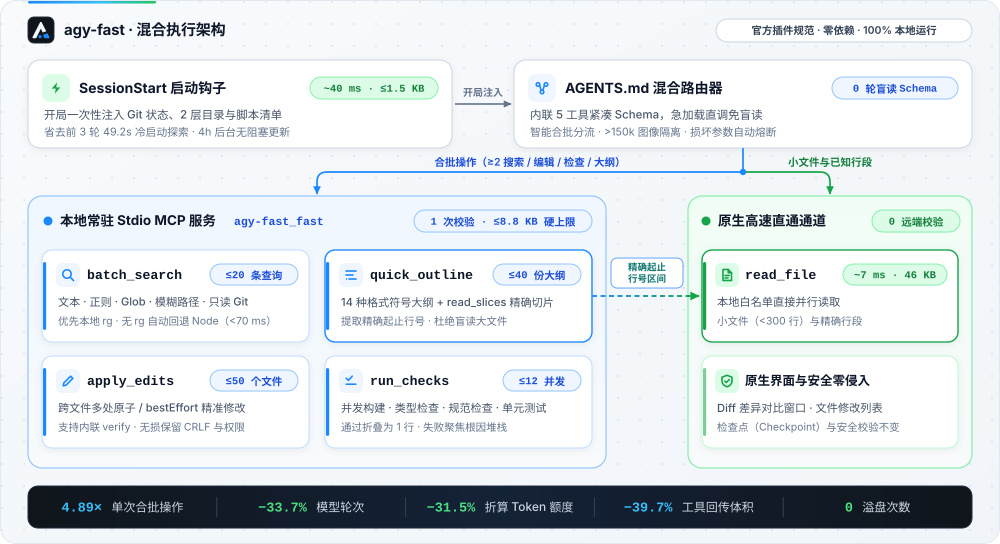

<div align="center">

<picture>
  <source media="(prefers-color-scheme: dark)" srcset="assets/logo-light.svg" />
  <source media="(prefers-color-scheme: light)" srcset="assets/logo-dark.svg" />
  
</picture>

# agy-fast

**面向 Google Antigravity 的合规延迟、Token 额度与工具调用加速插件**

[](CHANGELOG.md)
[](https://github.com/INK-Q/agy-fast/stargazers)
[](#快速开始)
[](#工作原理)
[](#快速开始)
[](LICENSE)
[](https://glama.ai/mcp/servers/INK-Q/agy-fast)
[](https://hol.org/registry/plugins/ink-q%2Fagy-fast?utm_source=hol_marketplace&utm_medium=plugins_badge&utm_campaign=plugins&utm_content=ink-q%2Fagy-fast&ref=plugin-author-5dc88d78)

[English](README.md) · 简体中文 · [快速开始](#快速开始) · [实测数据](#实测数据) · [MCP 工具](#5-个核心-mcp-工具) · [性能分析报告](docs/ANALYSIS_REPORT.zh-CN.md) · [更新日志](CHANGELOG.md)

</div>

<br />

**`agy-fast`** 是一款面向 **Google Antigravity**（CLI `agy`、Desktop 2.0 与 IDE）的零依赖、合规本地 [MCP](https://modelcontextprotocol.io/) 加速插件。它通过将高频代码搜索、多语言符号大纲提取、跨文件原子编辑与并发构建/测试合并为单次本地调用，并在会话启动时一次性注入 `<50 ms` 的工作区快照，显著降低任务耗时、Token 折算额度与上传流量——同时**完全无侵入**，不影响 Antigravity 原生界面、Diff 差异对比窗口、文件修改列表、检查点或安全校验。

| 每 10 操作模型轮次 | 综合折算 Token 额度 | 工具返回上传字节 | 溢盘与原生 UI 影响 |
| :---: | :---: | :---: | :---: |
| **-33.7%**<br><sub>`≥150k` 长上下文 `-38.2%` · 子代理 `-58.8%`</sub> | **-31.5%**<br><sub>`≥150k` 长上下文 `-36.5%` · 子代理 `-54.0%`</sub> | **-39.7%**<br><sub>未命中缓存新增输入 `-53.7%`</sub> | **0**<br><sub>`≤8.8 KB` 硬上限 · 原生 Diff 与 UI 零影响</sub> |

<p align="center">
  
</p>

## 快速开始

**环境要求：Node.js >= 20**（无需执行 `npm install`，仓库已附带未混淆的零依赖单文件 ESM 产物 `dist/*.mjs`）。可选安装 [`ripgrep` (`rg`)](https://github.com/BurntSushi/ripgrep) 进一步加速代码搜索（未安装时自动回退至纯 Node.js 并发遍历）。

### 一行命令安装（推荐）

自动安装运行文件到 `~/.gemini/config/plugins/agy-fast`，若本机存在 `agy` CLI 则自动执行严格校验与启用，并完成 MCP 与 `SessionStart` 实时自检：

**macOS / Linux：**
```bash
curl -fsSL https://raw.githubusercontent.com/INK-Q/agy-fast/main/install.sh | sh
```

**Windows（PowerShell）：**
```powershell
irm https://raw.githubusercontent.com/INK-Q/agy-fast/main/install.ps1 | iex
```

> [!TIP]
> **Desktop 2.0 / IDE 启用提示：** 打开 Antigravity 侧边栏的 **Customizations → Installed**，确认 `agy-fast` 已处于开启状态，然后开启一个**新会话**即可激活启动快照钩子与 MCP 工具。
>
> **以无需审批模式启动 `agy` CLI（可选）：** 如果希望在 CLI 中连续调用 `agy-fast` 等工具而不必每次手动确认审批，可使用官方参数启动：
>
> ```bash
> agy --dangerously-skip-permissions
> ```
>
> *（该参数会自动批准所有工具权限请求且不再弹窗询问，建议仅在受信任的代码仓库中使用，或配合 `--sandbox` 一起启用。）*

<details>
<summary>更多安装方式（本地克隆、直接克隆至插件目录、<code>agy</code> 官方 CLI、按项目团队共享、让 Antigravity 自动安装）</summary>

#### 本地克隆安装（全平台通用）
```bash
git clone https://github.com/INK-Q/agy-fast.git
cd agy-fast
node scripts/install.mjs install
```

#### 直接克隆到 Antigravity 插件目录（无需脚本）
Antigravity 会自动发现 `~/.gemini/config/plugins/` 下的插件：

```bash
# macOS / Linux
git clone https://github.com/INK-Q/agy-fast.git ~/.gemini/config/plugins/agy-fast
```

```powershell
# Windows (PowerShell)
git clone https://github.com/INK-Q/agy-fast.git "$env:USERPROFILE\.gemini\config\plugins\agy-fast"
```

#### 使用 `agy` 官方 CLI 安装
```bash
agy plugin install /path/to/agy-fast
agy plugin enable agy-fast
```

#### 按项目安装（适合团队仓库共享）
仅安装到指定代码仓库的 `.agents/plugins/agy-fast`：
```bash
node scripts/install.mjs install --project /path/to/your-repo
```

#### 直接让 Antigravity 自动安装
将以下指令直接发送给 Antigravity：
```text
请将 https://github.com/INK-Q/agy-fast.git 克隆到 ~/.gemini/config/plugins/agy-fast，运行 `node ~/.gemini/config/plugins/agy-fast/scripts/install.mjs doctor` 验证可用性，并启用 agy-fast 插件。
```

</details>

## 工作原理

基于 **55 个真实 Antigravity 会话**（**8,446 轮模型调用**、**17,302 次工具调用**、**55.25 小时**纯单 Agent 活跃时间，详见脱敏报告 [docs/ANALYSIS_REPORT.zh-CN.md](docs/ANALYSIS_REPORT.zh-CN.md)）的定量分析，任务慢的根因通常并非模型解码速度，而是 4 项结构性开销：

| 实测性能瓶颈 | 定量开销 | `agy-fast` 的解决方案 |
| :--- | :--- | :--- |
| **每轮固定首字等待（TTFT）** | 中位数 `~6.1 秒`（占中位数轮次约 `79%`；`68.1%` 轮次输出 `<700` tokens） | 单次 MCP 调用平均打包 **4.89** 个逻辑操作（子代理达 **5.95×**），大幅削减无效往返轮次（每轮 `~6–8 秒`） |
| **工具串行校验与细粒度拆分** | `52.5%` 的 `edit_file` 是同轮同文件拆分；`46.3%` 的 `run_command` 是只读搜索（中位数 `~2.0 秒` vs 本地 `rg` `2.1 ms`） | 在本地常驻 Stdio MCP 中一次合并最多 20 条搜索、50 个文件编辑 + `verify` 或 12 条并发检查命令 |
| **会话冷启动探索耗时** | 前 3 轮平均花费 **49.2 秒**检查目录结构、git 状态与脚本 | `SessionStart` 钩子仅在启动时运行一次（`~35–50 ms`），注入 `≤1.5 KB` 精简工作区快照 |
| **上下文膨胀与缓存失效** | `read_file` 占工具返回体积的 **81.9%**；`>60 秒` 间隔使缓存失效率从 `1.4%` 飙升至 `15.9%–93.8%` | 先提取符号大纲再并行精确读取、全工具死守 `≤8.8 KB` UTF-8 内联上限（杜绝 `output.txt` 溢盘）并隔离多模态截图 |

### 混合执行架构

`agy-fast` 不会取代原本就极快的内置读取，而是将“批量合并型操作”交给本地 MCP，同时把小文件与已知行段直接路由给本地白名单内置 `read_file`（`~7 ms`、单次 `46 KB` 内联、零远端校验）：

<p align="center">
  <picture>
    <source media="(prefers-color-scheme: dark)" srcset="assets/architecture-zh-dark.svg" />
    <source media="(prefers-color-scheme: light)" srcset="assets/architecture-zh-light.svg" />
    
  </picture>
</p>

### 插件组成

| 模块 | 文件路径 | 作用 |
| :--- | :--- | :--- |
| **原生插件清单** | [`plugin.json`](plugin.json) | 符合官方规范的元数据，通过 `agy plugin validate --strict` 零警告校验 |
| **本地常驻 MCP 服务** | [`mcp_config.json`](mcp_config.json) → [`dist/mcp-server.mjs`](dist/mcp-server.mjs) | 常驻本地进程，在 `agy-fast_fast` 下以急加载（`"eager": true`）暴露 5 个强类型合并工具 |
| **会话启动快照钩子** | [`hooks.json`](hooks.json) → [`dist/session-start.mjs`](dist/session-start.mjs) | 仅在 `SessionStart` 运行一次（`~35–50 ms`，内置 `250 ms` 扫描熔断与系统/用户目录黑名单），注入 `≤1.5 KB` 项目/Git/目录快照 |
| **工具路由与卫生规则** | [`rules/AGENTS.md`](rules/AGENTS.md) | 约 `6.5 KB` 精简路由规则，内联参数签名（支持自定义 `rules/AGENTS.local.md`，需带 `trigger: always_on` frontmatter，更新与重装自动保留） |
| **后台自动更新器** | [`dist/updater.mjs`](dist/updater.mjs) | 4 小时分离式后台检查，先暂存执行 MCP 冒烟校验再原子替换 |
| **离线基准测试工具** | [`dist/benchmark.mjs`](dist/benchmark.mjs) | 本地解析 `transcript.jsonl` 并输出单次指标或前后 A/B 对比 |

## 实测数据

基于连续 **10 天脱敏真实编码轨迹** 统计（**14 场基线主会话 / 5,771 轮** vs. **7 场启用 `agy-fast` 主会话 / 901 轮**，以及 **104 场基线 vs. 4 场插件子代理会话**；已剥离全部仓库名、路径与会话标识），`agy-fast` 单次调用平均打包 **4.89 个逻辑操作**（子代理达 **5.95×**）：

| 核心指标 *（按“单位有效操作”归一化）* | 主会话 · 基线 | 主会话 · `agy-fast` | 变化 | `≥150k` 长上下文主会话 | 子代理 |
| :--- | ---: | ---: | ---: | ---: | ---: |
| **每 10 操作所需模型轮次** | 5.23 轮 | **3.47 轮** | **-33.7%** | **-38.2%** | **-58.8%** |
| **每 10 操作上行请求数** *（LLM + 远端校验）* | 9.82 次 | **6.05 次** | **-38.4%** | **-42.6%** | **-62.0%** |
| **Prompt Cache 命中率** *（失效尖峰占比）* | 89.6% *(7.5%)* | **94.0%** *(4.8%)* | **+4.4 pp** | **95.0%** *(3.3%)* | 92.4% *(2.8%)* |
| **每操作全价新增输入（未命中缓存）** | 10,413 tok | **4,822 tok** | **-53.7%** | **-61.5%** | **-51.3%** |
| **每操作综合折算额度** *（权重 1 : 0.1 : 5）* | 22,458 eq | **15,387 eq** | **-31.5%** | **-36.5%** | **-54.0%** |
| **每操作工具返回上传字节** *（本地实测）* | 5.06 KB | **3.05 KB** | **-39.7%** | **-42.6%** | **-13.3%** |
| **每操作增量新增文本上传** *（增量同步口径）* | 35.6 KB | **16.5 KB** | **-53.7%** | **-61.6%** | **-51.3%** |
| **每操作全量历史文本上传** *（无状态重传估算）* | 342.2 KB | **276.2 KB** | **-19.3%** | **-21.9%** | **-58.9%** |

**`v0.2.x` 生产实测亮点：**
- **连续 134 次 MCP 调用 `0` 次溢盘**：全工具死守 `≤8.8 KB` UTF-8 内联硬上限，彻底消除输出落盘 `output.txt` 带来的二次读取损耗。
- **有效吞吐 `+75%`（`35.1 → 61.5 tok/s`），`>60s` 严重卡顿从 `31.2%` 降至 `7.4%`**：在同一场跨版本长会话前后对照（99 轮 vs. 374 轮）中，启用多模态隔离规则后主编码会话加载截图数降至 `0`，避开 `>180k` 上下文多模态 TTFT 悬崖。
- **`0` 次懒加载 Schema 盲读**：在 [`rules/AGENTS.md`](rules/AGENTS.md) 内联紧凑 Schema，跳过额外读取 `mcp/agy-fast_fast/*.json` 的轮次。

<details>
<summary>统计口径、多权重敏感性校验与固定 Prompt 开销说明</summary>

- **逻辑操作归一化**：1 次含 5 个查询的 `batch_search` 计 5 个操作，1 次含 6 处 hunk + `verify` 的 `apply_edits` 计 7 个操作，内置 `read_file`/`edit_file`/`run_command` 计 1 个操作，确保按“同等实际工作量”公平对比。
- **多权重敏感性校验**：标准权重（未缓存输入 `1.0` : 缓存读 `0.1` : 输出 `5.0`）下主会话省 **31.5%**（`≥150k` 长上下文省 **36.5%**）；换用保守缓存折扣（`1 : 0.25 : 4` → **-25.8%**）或高输出权重（`1 : 0.1 : 8` → **-29.4%**）结论一致。
- **固定 Prompt 开销**：`rules/AGENTS.md` + `SessionStart` 快照每会话合计仅增加 **~1.7k tokens**（第 2 轮起命中缓存，每轮约 `170` eq tokens）；只要省掉 **1 次多余轮次**（`~44k` eq tokens）或 1 次大文件盲读即可回本 **20 倍以上**。

</details>

### 本地离线验证你自己的日志（零数据上传）

```bash
# 统计本机全部 Antigravity 历史轨迹的基线指标
node dist/benchmark.mjs analyze --local

# 仅分析最近修改的 10 个本地会话
node dist/benchmark.mjs analyze --local --recent 10

# 按插件安装时间切分（兼容旧对话续聊），对比“已用 vs 未用 agy-fast”
node dist/benchmark.mjs analyze --local --since 2026-11-19T12:51:00+08:00 --split-usage

# 对比同一任务启用插件前后的指标变化
node dist/benchmark.mjs compare --before ./before/transcript.jsonl --after ./after/transcript.jsonl
```

## 5 个核心 MCP 工具

| 任务场景 | 推荐工具 | 核心原因 |
| :--- | :--- | :--- |
| 执行 ≥2 条文本、正则、Glob、模糊路径或只读 Git 查询 | **`batch_search`** | 1 次调用并发跑最多 20 条查询（本地 `<70 ms`） |
| 摸清未知大文件结构（`>300` 行） | **`quick_outline`** *（或 **`read_slices`**）* | 扁平 `paths` 参数一次提取最多 40 个文件符号大纲，避免盲读整文件 |
| 读取小文件（`<300` 行）或已知行号区间 | 内置 `read_file` | 本地白名单直放（`~7 ms`、单次 `46 KB`、零远端校验） |
| 同轮多处/跨文件编辑，或“编辑 + 校验” | **`apply_edits`** | 原子或 `bestEffort` 落盘 + 可选内联 `verify` |
| 执行 ≥2 条独立构建、检查、测试或诊断命令 | **`run_checks`** | 受控并发执行，头尾折叠提取核心报错与测试汇总 |

### 1. `batch_search` — 并发代码检索、模糊路径与只读 Git 查询
- **单次最多 20 条混合查询**：支持 `text`、`regex`、`glob`、`fuzzy` 与只读 `git`（`status`、`diff`、`log`、`show`、`branch`、`rev-parse`、`ls-files`、`blame`、`shortlog`、`describe`、`tag --list`、`remote -v`），并支持按条传入 `path` 跨目录/跨仓库查询。
- **精细控制**：支持 `fileType`（如 `typescript`、`python`、`gdscript`）与 `glob` 过滤、`outputMode`（`content` | `files_with_matches` | `count`）、跨行匹配 `multiline: true`（此时 `count` 统计逐文件匹配次数）、`type: "fuzzy"` 忽略大小写模糊路径查找以及 `glob` 的 `sortBy: "mtime"` 最新修改优先排序。
- **高容错与内联防溢盘**：优先调用 `rg`（缺失自动回退 Node.js），对常见 `glob` 误传（正则 `|` 与裸关键词）自动容错恢复，默认死守 `≤8.8 KB` UTF-8 内联上限。

### 2. `apply_edits` — 原子多处/跨文件编辑 + 内联校验
- **单次最多 50 个文件**：默认全内存预校验后原子写入（任意失配或重叠均不改动磁盘）；大批量可传 `bestEffort: true` 按文件原子提交成功项，并对失败项自动返回最相近代码行与行号漂移提示，便于精准重试。
- **无损保留文件属性**：保留 CRLF 换行符、文件权限与软链接；支持 `startLine`/`endLine`、`replaceAll`、`create`/`overwrite` 与 `dryRun`。
- **可选内联 `verify`**：落盘后直接执行构建/类型检查/测试命令，自动过滤 Pino/Bunyan info JSON 与 Maven 尾注噪声，保留核心报错根因。

### 3. `quick_outline` — 极简多语言符号大纲提取
- **扁平参数，单次最多 40 个文件** *（推荐 10–20 个/批）*：仅需传入扁平 `paths: string[]` 即可提取起止行号，覆盖 **TypeScript / JavaScript** *（含 Fastify/Express 路由与测试块）*、**HTML / Vue / Svelte**、**CSS / SCSS / Less**、**Python**、**Godot GDScript（`.gd`）**、**Go**、**Rust**、**Java / Kotlin / C# / Swift / C / C++**、**Shell**、**Markdown** 与 **JSON / YAML**，配合并行内置 `read_file` 极简顺手。

### 4. `read_slices` — 符号大纲 + 精确行段切片
- **大纲与小切片合一**：支持同等 15 种格式符号大纲（支持单文件广度优先水填充分配），并可在同一次请求中顺带读取少量小行段（总输出死守 `≤8.8 KB` UTF-8 上限）；大段正文读取自动引导至并行内置 `read_file`。

### 5. `run_checks` — 并发构建、规范检查、测试与诊断执行器
- **单次最多 12 条命令**：在受控并发池（`concurrency: 1..8`）中并行执行独立非交互命令，支持单条超时强杀（`1..170 s`，单次调用共享 `170 s` 预算以适配 Antigravity `180 s` MCP 上限）、ANSI 转义符清理，并在 Windows 下自动透明解包针对白名单 CLI（`git`/`npm`/`node`/`rg`/`pytest`/`cargo` 等）的冗余 `powershell -Command "..."` 包装，免去 PowerShell 冷启动开销（PowerShell cmdlet、别名与管道完全原样保留）。
- **头尾折叠（Head-Tail）双输出模式**：默认 `compact` 模式将通过项折叠为 1 行摘要、超长失败日志采用**头尾折叠**（同时保留首条根因报错与末尾测试汇总/堆栈尾部）；`full` 模式在 `≤8.8 KB` 预算内保留标准输出，超限时同样采用头尾折叠。

<details>
<summary>批量 MCP 调用示例（JSON 参数）</summary>

**`batch_search` — 单次并发执行 3 类异构查询：**
```json
{
  "queries": [
    { "type": "regex", "pattern": "export (async )?function", "fileType": "typescript", "outputMode": "files_with_matches" },
    { "type": "fuzzy", "pattern": "mcp server" },
    { "type": "git", "pattern": "status --short" }
  ]
}
```

**`apply_edits` — 跨文件编辑 + 内联类型检查一步完成：**
```json
{
  "edits": [
    { "path": "src/a.ts", "hunks": [{ "target": "oldCall()", "replacement": "newCall()" }] },
    { "path": "src/b.ts", "hunks": [{ "target": "v1", "replacement": "v2", "startLine": 10, "endLine": 25 }] }
  ],
  "bestEffort": true,
  "verify": "npm run typecheck"
}
```

</details>

## 日常维护与更新

### 常用维护命令

| 操作 | 命令 |
| :--- | :--- |
| **健康检查** *（Node 版本、`rg`、MCP 实时握手、`SessionStart` 延迟、严格清单校验）* | `node ~/.gemini/config/plugins/agy-fast/scripts/install.mjs doctor` |
| **仅检查更新** *（不修改文件）* | `node ~/.gemini/config/plugins/agy-fast/scripts/install.mjs update --check` |
| **立即更新并自检** *（先暂存冒烟校验再替换）* | `node ~/.gemini/config/plugins/agy-fast/scripts/install.mjs update` |
| **配置自动更新策略** *（`auto` \| `notify` \| `off`）* | `node ~/.gemini/config/plugins/agy-fast/scripts/install.mjs config --auto-update notify --interval 24` |
| **切换 MCP 工具加载模式** *（`eager` \| `lazy`，自动更新保留）* | `node ~/.gemini/config/plugins/agy-fast/scripts/install.mjs config --tool-loading lazy` |
| **CLI 直调模式** *（供 Swarm Worker 及无 MCP 环境通过 `run_command` 调用）* | `node ~/.gemini/config/plugins/agy-fast/dist/mcp-server.mjs --cli <search\|outline\|slice\|edit\|check>` |
| **一键干净卸载** | `node ~/.gemini/config/plugins/agy-fast/scripts/install.mjs uninstall` |

> 在本地克隆目录中，也可直接使用 `./install.sh <子命令>`（macOS/Linux）或 `.\install.ps1 <子命令>`（Windows）执行上述全部子命令。

### 零启动延迟的后台自动更新

- **0 ms 启动阻塞**：每 **4 小时**在 `SessionStart` 吐出快照*之后*，异步拉起完全分离的后台更新进程（`dist/updater.mjs`）。
- **先验证、再原子替换**：优先通过 `git ls-remote --tags`（无 `git` 时回退 GitHub Releases API）检测新版本，克隆至隔离暂存目录并完成 **MCP 实时冒烟校验**后，再按文件原子替换；损坏版本会被自动拦截，且用户自定义的 `rules/AGENTS.local.md`（需带 `---\ntrigger: always_on\n---` YAML frontmatter 以便 Antigravity 加载，已加入 `.gitignore`）在自动更新与手动重装时均会被完整保留。
- **安全保护**：常规复制安装与干净的直接 `git clone` 安装会自动更新；`--link` 开发软链接与有未提交改动的仓库**绝不覆盖**（仅提示有新版本）。更新完成后将在下一次新会话开头展示一次性提示。

<details>
<summary>环境变量覆盖与更新生效说明</summary>

| 环境变量 | 可选值 / 默认值 | 说明 |
| :--- | :--- | :--- |
| `AGY_FAST_AUTO_UPDATE` | `auto` *（默认）* \| `notify` \| `off` | 覆盖已保存的自动更新模式 |
| `AGY_FAST_UPDATE_INTERVAL_HOURS` | `12` *（默认；`1..720`）* | 后台检查间隔（小时） |
| `AGY_FAST_UPDATE_CHANNEL` | `release` *（默认）* \| `main` | 跟踪稳定发版标签或 `main` 分支 |
| `AGY_FAST_REPO` | Git 仓库地址 | 自定义镜像或 Fork 仓库地址 |
| `AGY_FAST_EDITS_FORMAT` | `auto` *（默认）* \| `array` \| `string` | 控制 `apply_edits.edits` 参数格式策略（`auto` 在支持 `"eager": true` 的 CLI ≥1.5.8、桌面端 2.0、IDE 与第三方客户端统一走省 token 的强类型原生数组，在旧版懒加载 CLI 1.5.0–1.5.7 自动切换为 JSON 数组字符串以防 `[]` 丢参；服务端始终同时兼容两种格式） |
| `AGY_FAST_HOST` | 如 `cli@1.5.14`、`ide@2.7.0`、`desktop@2.34.0` | 手动覆盖自动探测到的 Antigravity 宿主端类型与版本 |

**更新生效提示：** 新版 `rules/AGENTS.md` 与 `dist/session-start.mjs` 在下一次开启新会话时自动生效；Antigravity Desktop 2.0 / IDE 若需立即刷新常驻 MCP 服务，重载窗口或重启一次即可。

</details>

## 合规与安全

- **严格遵守官方接口**：仅使用 Antigravity 官方文档定义的插件扩展机制（`plugin.json`、`mcp_config.json`、`hooks.json`、`rules/AGENTS.md`）。
- **完全无侵入**：绝不影响 Antigravity 本身的表现与原生行为，**Diff 差异对比窗口**、**文件修改列表**、检查点与内置工具均保持原样工作。
- **不篡改安全与程序文件**：不修改客户端程序文件，不绕过、不禁用任何内置安全评估机制或认证流程。
- **零每步阻塞钩子**：不注册 `PreToolUse`、`PostToolUse`、`PreInvocation`、`PostInvocation` 或 `Stop` 钩子。
- **失败放行启动钩子**：`SessionStart` 遇到不可读目录或异常输入时返回 `{}` 并正常退出，绝不阻断会话启动。
- **本地优先且源码透明**：全部 MCP 工具与基准测试均在本地离线执行，零代码或日志上传；预构建 `dist/*.mjs` 产物不混淆，每一行执行代码均可直接审计。

## 常见问题

### 安装 `agy-fast` 会影响 Antigravity 的原生界面、Diff 窗口或文件修改列表吗？
不会。`agy-fast` 完全运行在官方本地 Stdio MCP 与 `SessionStart` 插件接口之上，不修改客户端程序，也不会干扰 Antigravity 原生的 Diff 差异对比窗口、文件修改列表、检查点、内置工具或安全校验。

### 除了提速，`agy-fast` 还能省 Token 额度和上传流量吗？
可以。在连续 10 天脱敏真实编码日志实测中，单次 MCP 调用平均打包约 4.9 个操作，使每 10 次操作的模型轮次降低 **33.7%**、综合折算 Token 额度降低 **31.5%**（`≥150k` 长上下文省 **36.5%**，子代理省 **54.0%**）、工具回传上传字节降低 **39.7%**，且 `>60s` 卡顿轮次从 **31.2% 降至 7.4%**。

### `agy-fast` 会替代 Antigravity 内置的 `read_file` 或 `edit_file` 吗？
不会，两者是互补的混合协作模式。Antigravity 内置 `read_file` 属于本地白名单放行（`~7 ms`、单次 `46 KB`、零远端校验），因此小文件与已知行段仍直接并行使用内置 `read_file`；而批量搜索、大文件大纲提取、跨文件/多处原子编辑（含 `verify`）以及并发检查则交由 `agy-fast` 合并执行。

### 支持哪些 Antigravity 客户端与操作系统？
同时支持 **Antigravity CLI（`agy`）**、**Antigravity Desktop 2.0** 与 **Antigravity IDE**，兼容 **macOS、Linux 与 Windows**。仅需 **Node.js >= 20** 且零运行期依赖（可选安装 `ripgrep`/`rg`，缺失时自动回退纯 Node.js）。

### `agy-fast` 会向外部上传代码或会话日志吗？
不会。全部 5 个 MCP 工具、`SessionStart` 快照以及离线基准测试均 100% 在本机运行。唯一的可选外网动作是每 4 小时检查一次 GitHub 公开 Release 标签以支持自动更新，可随时通过 `config --auto-update off` 或 `AGY_FAST_AUTO_UPDATE=off` 完全关闭。

### 如何验证本机加速效果或彻底卸载？
运行 `node dist/benchmark.mjs analyze --local --split-usage` 即可纯离线统计本机日志的前后对比。随时可执行 `node ~/.gemini/config/plugins/agy-fast/scripts/install.mjs uninstall` 一键干净卸载。

## 本地开发与测试

```bash
npm install
npm run typecheck   # TypeScript 严格类型检查
npm run build       # 使用 esbuild 打包 src/*.ts -> dist/*.mjs
npm test            # 运行单元测试、MCP 协议测试、Hook 测试、基准测试与安装器测试
npm run bench:stress # 运行 12 场景端到端压测与性能基准套件
npm run validate    # 运行 `agy plugin validate --strict .`
```

## MCP 目录收录

<a href="https://glama.ai/mcp/servers/INK-Q/agy-fast">
  
</a>

## Star History

<a href="https://www.star-history.com/#INK-Q/agy-fast&Date">
  <picture>
    <source media="(prefers-color-scheme: dark)" srcset="https://api.star-history.com/svg?repos=INK-Q/agy-fast&type=Date&theme=dark" />
    <source media="(prefers-color-scheme: light)" srcset="https://api.star-history.com/svg?repos=INK-Q/agy-fast&type=Date" />
    
  </picture>
</a>

## 开源协议

[MIT](LICENSE)
